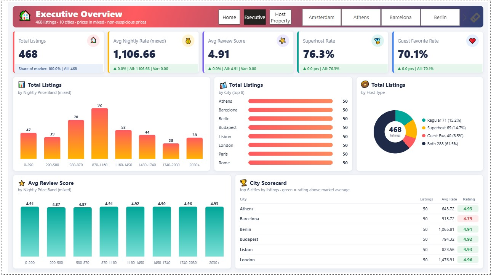

# 🌍 European Airbnb Listings & Price Performance Analysis

An end-to-end **Data Engineering, SQL Analytics, and Business Intelligence** project analyzing Airbnb listings across 10 major European cities.

This project combines web scraping, data cleaning, SQL Server analytics, and interactive Power BI dashboards to uncover pricing patterns, listing quality, host performance, and value-for-money opportunities in the European short-term rental market.

---

## 📊 Dashboard Preview

### 🏠 Home — Project Overview

.jpg)

### 📈 Executive Overview



### 🏡 Host & Property Analysis


---

## 🎯 Business Objectives

- Analyze Airbnb listing prices across 10 European cities.
- Identify pricing patterns and differences between markets.
- Evaluate listing quality using ratings and review counts.
- Investigate the relationship between host badges and listing performance.
- Identify potential best-value properties based on price and rating.
- Build an interactive dashboard to support data-driven decisions.

---

## 🛠️ Tech Stack

| Category | Tools & Technologies |
|---|---|
| Web Scraping | Python, Selenium WebDriver |
| Data Cleaning | Pandas, NumPy, Regular Expressions |
| Database | Microsoft SQL Server, T-SQL |
| SQL Analytics | Views, CTEs, Window Functions, Aggregations |
| Business Intelligence | Power BI, DAX, Power Query |
| Visualization | Interactive Charts, KPI Cards, HTML/CSS Visuals |
| Version Control | Git, GitHub |

---

## 🔄 End-to-End Data Pipeline

### 1. Web Scraping
**Notebook:** `01_web_scraping.ipynb`

- Automated browser-based data collection using Selenium.
- Collected 460+ Airbnb listings across 10 European cities.
- Extracted property information, prices, ratings, reviews, and host-related attributes.

### 2. Data Cleaning & Transformation
**Notebook:** `02_data_cleaning.ipynb`

- Cleaned and standardized raw price values.
- Extracted numeric price amounts and currency codes.
- Handled missing values and unparseable price strings.
- Converted columns to appropriate data types.
- Flagged suspicious prices and potential review outliers.

### 3. SQL Server Database & Analytics

Imported the cleaned dataset into SQL Server and developed analytical views:

- `v_master`: Consolidated master dataset.
- `v_price_ready`: Listings with valid, non-suspicious price values.
- `v_ratings_ready`: Listings prepared for rating analysis after applying review-outlier rules.

These views provide a reusable foundation for consistent SQL analysis and Power BI reporting.

### 4. Business Analysis with SQL

Developed analytical queries to investigate:

- City-level listing distribution and price differences.
- Best-value listings based on price and rating.
- Host performance and badge-related patterns.
- Rating and review distributions.
- Top-performing properties and market comparisons.

### 5. Interactive Power BI Dashboard

Designed a three-page dashboard experience:

- **Home:** Project landing page and navigation.
- **Executive Overview:** Market KPIs, price bands, host types, ratings, and city scorecard.
- **Host & Property:** Review distribution, host and guest mix, price-versus-rating analysis, and top listings.

---

## 💡 Key Business Insights

### 1. Market Overview
The collected dataset contains **468 listings across 10 European cities**, with an overall average review score of approximately **4.91**.

**Business implication:** Ratings are generally high across the observed listings. Price and review volume can help distinguish properties beyond rating alone.

### 2. City-Level Differences
The dashboard reveals substantial differences in average nightly prices and review volumes across cities.

**Business implication:** Pricing strategies should account for local market conditions instead of applying a single price benchmark across all destinations.

### 3. Host & Guest Preferences
The dashboard compares Superhost status, regular hosts, and Guest Favorite listings.

**Business implication:** Host badges can be investigated as potential indicators of guest trust and listing performance. Further statistical testing is needed before attributing better ratings or more reviews to badge status.

### 4. Best-Value Opportunities
Listings can be ranked using a combined price-and-rating approach.

**Business implication:** Travelers can compare affordability and perceived quality, while hosts can benchmark their prices against similarly rated properties.

> **Analytical note:** Price, currency, review-count, and listing-eligibility filters must be applied consistently. Relationships observed in this dataset should not automatically be interpreted as causal effects or generalized to the entire Airbnb market.

---

## 📁 Project Structure


European-Airbnb-Analysis/
│
├── assets/
│   ├── Home.png
│   ├── Executive.png
│   └── Host_Property.png
│
├── notebooks/
│   ├── 01_web_scraping.ipynb
│   └── 02_data_cleaning.ipynb
│
├── sql/
│   ├── 01_*.sql
│   ├── 02_*.sql
│   └── 03_*.sql
└── README.md
```

*The structure above is illustrative. Adjust file and folder names to match the actual repository.*

---

##  How to Run the Project

### Prerequisites

- Python 3.x
- Google Chrome and a compatible Selenium WebDriver setup
- Microsoft SQL Server
- Power BI Desktop

### Step 1 — Install Python Dependencies

```bash
pip install pandas numpy selenium matplotlib seaborn pyodbc
```

Install any additional dependencies imported by the notebooks.

### Step 2 — Run the Notebooks

Run the scraping notebook followed by the cleaning notebook:

1. `01_web_scraping.ipynb`
2. `02_data_cleaning.ipynb`

Review the notebook configuration and output paths before execution.

### Step 3 — Set Up SQL Server

1. Create or select your SQL Server database.
2. Import the cleaned dataset.
3. Execute the SQL scripts in the intended dependency order.
4. Verify that the analytical views are created successfully.


##  Data Limitations

- The analysis covers the listings collected for this project, not the entire Airbnb marketplace.
- Scraped data represents a snapshot in time and may change.
- Listings with different currencies or invalid prices require careful handling before price comparisons.
- Host badges and guest reviews indicate associations, not necessarily causation.
- Findings depend on the selected cities, collected listings, and applied cleaning rules.

---

## Author

**Sandy Reda**

Data Science & AI 

⭐ If you find this project useful, feel free to explore the repository and share your feedback.
